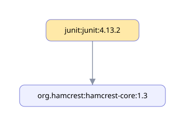
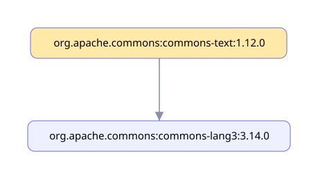
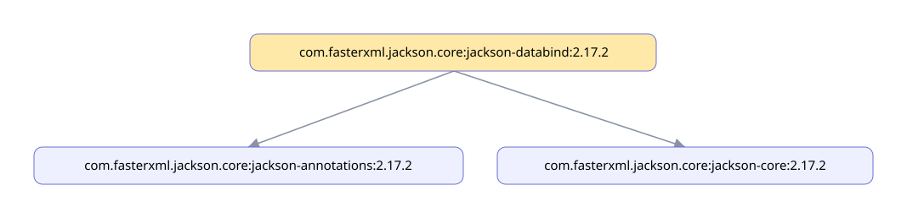
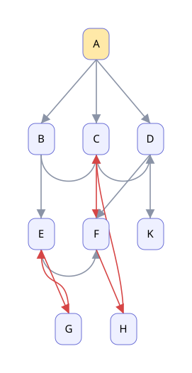

# depviz — визуализация графа зависимостей Maven

Практическая работа №2 по дисциплине «Конфигурационное управление», вариант 20.

## Общее описание

`depviz` — консольное приложение (CLI) на Python 3, которое строит граф
зависимостей пакета менеджера пакетов Maven (Java) и рисует его на языке
диаграмм Mermaid. Используется только стандартная библиотека Python:
готовые менеджеры пакетов и библиотеки для получения зависимостей (и для
чтения YAML) не используются.

Что умеет программа:

1. Читать настройки из файла YAML и проверять их (этап 1).
2. Получать прямые зависимости заданной версии пакета из репозитория
   Maven по URL (этап 2).
3. Строить полный граф зависимостей обходом в ширину (BFS) без рекурсии,
   с ограничением глубины и обработкой циклов; работать с тестовым
   репозиторием из файла (этап 3).
4. Выводить обратные зависимости — пакеты, которые зависят от заданного
   (этап 4).
5. Формировать текст диаграммы Mermaid и показывать изображение графа
   (этап 5).

## Настройки (файл YAML)

| Параметр | Описание | Пример |
|---|---|---|
| `package` | имя пакета `groupId:artifactId` | `junit:junit` |
| `repository` | URL репозитория или путь к файлу тестового репозитория | `https://repo1.maven.org/maven2` |
| `test_mode` | режим работы с тестовым репозиторием (`true` / `false`) | `false` |
| `version` | версия пакета | `4.13.2` |
| `max_depth` | максимальная глубина анализа (целое ≥ 1) | `3` |
| `mode` | необязательный: `graph` (по умолчанию), `reverse`, `mermaid` | `mermaid` |
| `output_dir` | необязательный: папка для картинок (по умолчанию `out`) | `out` |

```yaml
# configs/junit.yaml
package: junit:junit
repository: https://repo1.maven.org/maven2
test_mode: false
version: 4.13.2
max_depth: 3
```

YAML читается собственным модулем `yamlconf.py` (в стандартной библиотеке
Python нет модуля для YAML): строки `ключ: значение`, комментарии `#`,
значения в кавычках, разделитель `---`. Относительный путь к тестовому
репозиторию считается от папки, где лежит файл настроек.

### Обработка ошибок

При ошибке выводится `error: ...` и код выхода 1:

- нет файла; строка не в формате `ключ: значение`; вложенные значения;
  повтор ключа;
- неизвестный, пропущенный или пустой параметр;
- имя пакета не `groupId:artifactId` (в тестовом режиме — только `A-Z`);
- `repository` не URL или файл тестового репозитория не найден;
- `test_mode` не `true`/`false`; недопустимые символы в версии;
- `max_depth` не число или меньше 1;
- неизвестный `mode`, `mode: reverse` без тестового репозитория;
- пакета или версии нет в репозитории, испорченный POM, репозиторий
  недоступен;
- ошибка формата файла тестового репозитория (с номером строки),
  корневого пакета нет в тестовом репозитории.

## Как это работает

### Откуда берутся зависимости (этап 2)

Источник — репозиторий Maven (Maven Central `https://repo1.maven.org/maven2`).
Каждая версия пакета описана XML-файлом POM по адресу
`{repository}/{groupId с / вместо .}/{artifactId}/{version}/{artifactId}-{version}.pom`.
Файл скачивается модулем `urllib`, XML разбирается модулем
`xml.etree.ElementTree`.

Чтобы узнать версии зависимостей, программа, как и Maven, учитывает:

- **родительские POM** (`<parent>`): свойства, `dependencyManagement`
  и зависимости наследуются;
- **свойства** `${...}`, в том числе встроенные `${project.version}`;
- **dependencyManagement** — версия берётся оттуда, если в зависимости её
  нет; **BOM** (`scope=import`) тоже учитываются;
- диапазон версий `[1.0,2.0)` — берётся нижняя граница.

Цепочка родителей и BOM обходится на явном стеке, без рекурсии.
Прямыми зависимостями считаются `compile` и `runtime`; `test`, `provided`,
`system` и `optional` пропускаются.

### Граф (этап 3)

Граф строится обходом в ширину (BFS) без рекурсии (`graph.build_graph`):
очередь `collections.deque`, словарь глубин служит множеством посещённых
вершин. Каждая вершина раскрывается один раз, поэтому циклические
зависимости не приводят к зацикливанию. Вершины на глубине `max_depth`
не раскрываются (`... (max depth reached)`). Вершина графа —
`groupId:artifactId:version`. Циклы ищутся обходом в глубину на явном
стеке (`graph.find_cycles`). Если POM зависимости не найден, выводится
предупреждение `warning: ...`, обход продолжается.

### Тестовый режим

При `test_mode: true` в `repository` указывается путь к файлу описания
графа. Пакеты называются большими латинскими буквами, формат строки —
`ПАКЕТ: ЗАВИСИМОСТИ`, `#` — комментарий:

```
# tests/repos/cycle.txt
A: B
B: C
C: A D
D:
```

| Файл | Случай |
|---|---|
| `simple.txt` | общая зависимость (D нужна и B, и C) |
| `chain.txt` | длинная цепочка — проверка `max_depth` |
| `cycle.txt` | цикл A → B → C → A |
| `self.txt` | пакет зависит сам от себя |
| `complex.txt` | два цикла и неописанный лист K |
| `bad_format.txt`, `bad_name.txt` | ошибки формата |

### Обратные зависимости (этап 4)

При `mode: reverse` выводятся пакеты, которые зависят от заданного
(напрямую и транзитивно). Используется тот же BFS (`build_graph`), но
вместо функции «зависимости пакета» ему передаётся функция «кто зависит
от пакета» (`FileSource.reverse_source`), построенная разворотом всех
рёбер тестового репозитория (`graph.reverse_edges`). Режим работает для
тестового репозитория: POM хранит только прямые зависимости пакета, и
чтобы найти обратные, пришлось бы скачать весь Maven Central.

### Визуализация (этап 5)

При `mode: mermaid` программа:

1. формирует текст диаграммы Mermaid (`mermaid.to_mermaid`) и выводит его;
2. сама рисует картинку графа в `out/<пакет>.svg` (`svg.to_svg`) — без
   интернета и сторонних библиотек; файл открывается в VS Code или
   браузере;
3. сохраняет `.mmd` и HTML-страницу и открывает её в браузере
   (`mermaid.show`) — там рисует библиотека Mermaid.

Пакеты стоят по уровням (уровень = глубина BFS), корень жёлтый, стрелки
циклов красные, обрезанные по глубине пакеты — пунктиром.

**junit:junit 4.13.2**



**org.apache.commons:commons-text 1.12.0**



**com.fasterxml.jackson.core:jackson-databind 2.17.2**



**Тестовый репозиторий complex (два цикла — красные стрелки)**



## Сравнение со штатным инструментом `mvn dependency:tree`

Штатный инструмент Maven — `mvn dependency:tree`. Для пустого проекта
с одной зависимостью он показывает (scope `compile`):

```
\- junit:junit:jar:4.13.2:compile
   \- org.hamcrest:hamcrest-core:jar:1.3:compile

\- org.apache.commons:commons-text:jar:1.12.0:compile
   \- org.apache.commons:commons-lang3:jar:3.14.0:compile

\- com.fasterxml.jackson.core:jackson-databind:jar:2.17.2:compile
   +- com.fasterxml.jackson.core:jackson-annotations:jar:2.17.2:compile
   \- com.fasterxml.jackson.core:jackson-core:jar:2.17.2:compile
```

Для этих трёх пакетов depviz даёт **те же пакеты и версии**: версии
`jackson-annotations` и `jackson-core` берутся через свойства
`${jackson.version.annotations}` / `${jackson.version.core}` из
родительских POM (`jackson-base` → `jackson-bom`), версия `hamcrest-core`
— из свойства `${hamcrestVersion}`. Тестовые зависимости (`junit-jupiter`,
`assertj-core`, `mockito` и другие) обе программы не показывают.

### Возможные расхождения в общем случае

1. **Выбор одной версии.** Если разные пакеты требуют разные версии одной
   библиотеки, Maven оставляет одну («nearest wins» — ближайшая к корню),
   а depviz показывает каждую версию отдельной вершиной.
2. **Исключения** (`<exclusions>`) Maven применяет к поддереву; depviz их
   не учитывает.
3. **Профили** (`<profiles>`, зависимости для JDK или ОС) Maven включает по
   условиям; depviz профили не читает.
4. **Диапазоны версий** Maven разрешает по `maven-metadata.xml` (берёт
   подходящую новую версию), depviz берёт нижнюю границу.
5. **Вид вывода:** `mvn dependency:tree` печатает дерево, повторы
   пропускает; depviz выводит граф — каждый пакет один раз.

## Функции

| Модуль | Функция | Назначение |
|---|---|---|
| `yamlconf.py` | `read_yaml`, `parse_yaml` | прочитать и разобрать YAML |
| `config.py` | `load_config`, `read_values` | прочитать и проверить параметры |
| `config.py` | `parse_bool`, `parse_depth`, `check_package`, `check_repository`, `check_version`, `check_mode` | проверки |
| `maven.py` | `pom_url`, `download` | адрес POM и скачивание (`urllib`) |
| `maven.py` | `parse_pom` | разобрать XML файла POM |
| `maven.py` | `MavenRepository.effective` | POM с родителями и BOM (стек) |
| `maven.py` | `MavenRepository.direct_dependencies` | прямые зависимости версии |
| `maven.py` | `substitute`, `pick_version` | свойства `${...}`, диапазоны версий |
| `sources.py` | `FileSource`, `MavenSource`, `make_source` | источники данных |
| `sources.py` | `FileSource.reverse_source` | «кто зависит от пакета» |
| `graph.py` | `build_graph` | BFS без рекурсии с ограничением глубины |
| `graph.py` | `find_cycles`, `reverse_edges` | циклы, разворот рёбер |
| `mermaid.py` | `to_mermaid`, `save`, `show` | текст Mermaid, HTML, браузер |
| `svg.py` | `layout`, `to_svg`, `save_svg` | картинка графа SVG |
| `__main__.py` | `print_graph`, `print_reverse`, `print_cycles`, `visualize` | вывод |
| `__main__.py` | `run`, `main` | запуск по настройкам, коды выхода |

## Запуск и тесты

Нужен только Python 3.8+. Устанавливать ничего не нужно.

```sh
./run.sh configs/junit.yaml
./tests/sh/stage1.sh      # ошибки настроек
./tests/sh/stage2.sh      # прямые зависимости
./tests/sh/stage3.sh      # граф, глубина, циклы
./tests/sh/stage4.sh      # обратные зависимости
./tests/sh/stage5.sh      # Mermaid и картинки
PYTHONPATH=src python3 -m unittest discover -s tests -t .
```

## Примеры

```
$ ./run.sh configs/test_cycle.yaml
dependency graph of A (max_depth = 10)
packages: 4, edges: 4
  [0] A -> B
  [1] B -> C
  [2] C -> A, D
  [3] D
cycles: 1
  A -> B -> C -> A

$ ./run.sh configs/reverse_simple_d.yaml
reverse dependencies of D (max_depth = 10)
packages: 4, edges: 4
  [0] D <- B, C
  [1] B <- A
  [1] C <- A
  [2] A
packages depending on D: B, C, A
cycles: none

$ ./run.sh configs/junit.yaml
dependency graph of junit:junit:4.13.2 (max_depth = 3)
packages: 2, edges: 1
  [0] junit:junit:4.13.2 -> org.hamcrest:hamcrest-core:1.3
  [1] org.hamcrest:hamcrest-core:1.3
cycles: none
```
